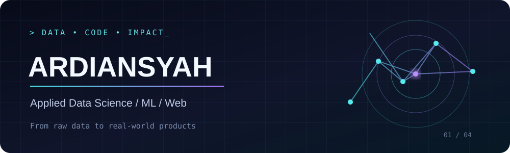

<!-- Rename this file to README.md. Upload assets/header.svg alongside it. -->
<div align="center">
  
  <br /><br />
  <a href="https://tedubuamo.github.io/portofolio"></a>
  <a href="https://www.linkedin.com/in/ardiansyah-indra-febrianto/"></a>
  <a href="mailto:indrardi92@gmail.com"></a>
</div>

<br />

### `> whoami`

I'm **Ardiansyah**, an Applied Data Science student building data products, machine learning models, and web applications. I enjoy taking a project from raw data to a usable interface, with a focus on forecasting, analytics, and products that solve practical problems.

```yaml
current_focus: Forecasting · Data Products · Full-Stack Development
interests: Renewable Energy · Agriculture · Computer Vision
open_to: Internships · Collaboration
```

### `> featured_projects`

| Project | Snapshot | Stack |
| :--- | :--- | :--- |
| **☀️ On-Grid PV Forecasting** | LSTM-based concept for solar power and energy forecasting, with confidence interval planning. | Python · LSTM · Time Series |
| **🌾 Agri-Dash Blitar** | Agriculture and food security dashboard with regional maps and interactive charts. | JavaScript · Tailwind CSS · Chart.js · Leaflet |
| **📊 Marketing Fee Monitoring** | Role-based reporting and monitoring system with an API, dashboards, and PDF exports. | Django · Next.js · PostgreSQL |
| **🌋 Earthquake Impact Mapping** | Geospatial exploration of earthquake clusters and affected areas. | Python · ACO · Folium · Pandas |

*When the repositories are public, link each project title to its repository or live demo.*

### `> tech_stack --all`

**Languages & data**

     

**Data science & visualization**

        

**Web & infrastructure**

       

### `> current_trajectory`

- Building better forecasting workflows for real sensor data.
- Improving model evaluation and deployment practices.
- Turning analysis into dashboards people can understand and use.

---

<div align="center">
  <strong>Have a project, idea, or internship opportunity?</strong><br /><br />
  <a href="mailto:indrardi92@gmail.com">Let's connect</a> · <a href="https://tedubuamo.github.io/portofolio">See my portfolio</a> · <a href="https://github.com/tedubuamo?tab=repositories">Explore my repositories</a>
</div>
